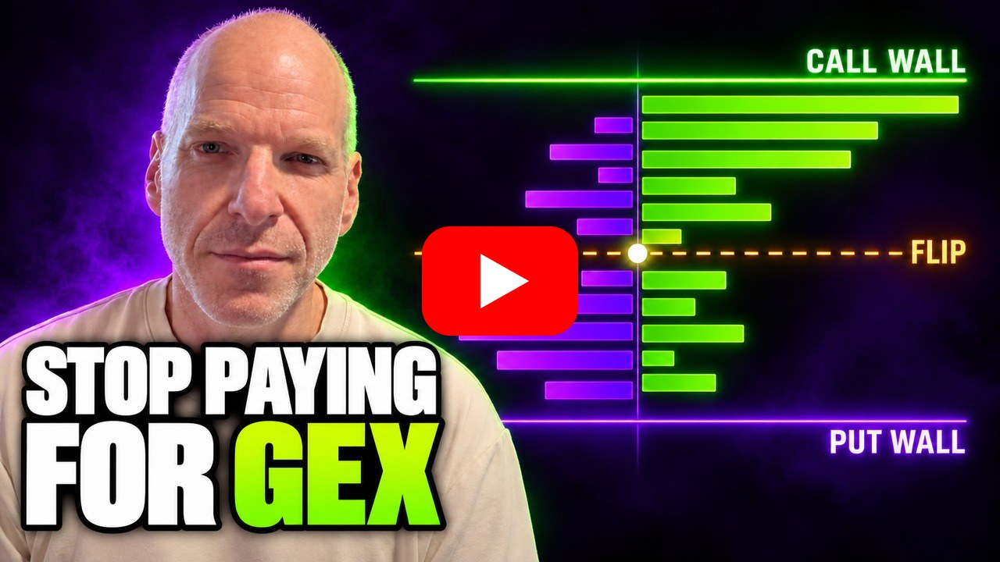

# Edge GEX Lab

[](https://github.com/simonro/Edge-GEX-Lab/actions/workflows/ci.yml)
[](https://github.com/simonro/Edge-GEX-Lab/releases/latest)
[](LICENSE)

A local live map of modeled option gamma exposure (GEX) by strike for SPY, QQQ, SPX, NDX and any
optionable US stock. It shows the call wall, the put wall, every gamma flip, the regime at spot, how big
net GEX is next to the stock's own daily dollar volume, and a trade guidance panel that turns the map
into levels and scenarios with every number traceable to the map. Built for active traders who want to
see where option gamma sits without paying for a GEX service.

- **Runs on your computer.** No account, no telemetry, the server listens on `127.0.0.1` only.
- **Every number is shown with how it was made.** OI date and source, feed, valuation time, coverage
  and the sign assumption are on the map, not in a footnote.
- **AI is optional and fenced.** The guidance is a deterministic template. "Explain this map" can ask
  your local `claude` CLI for a narrative; a validator rejects any number or promise not in the data.
- **Market data you control.** Your own Alpaca keys (the free plan works) plus Cboe's public delayed
  quotes. REST only, rate capped.
- **Free and MIT licensed.** No paid tier.

**[Quick start](#quick-start)** · **[Releases](https://github.com/simonro/Edge-GEX-Lab/releases)** · **[Privacy](#privacy-and-your-data)**

**What this is not:** Not financial advice. Not a signal service. The trade guidance is the textbook
dealer-gamma reading of a model, untested, and says so on screen. Every screenshot below is synthetic
demo data, not live market data.


[](https://youtu.be/okQVLf2s3GI)

**[I Built a Free Gamma Exposure (GEX) Map You Can Understand](https://youtu.be/okQVLf2s3GI)**: what GEX
is and how traders use it, then the tool itself on demo data.

## Privacy and your data

Edge GEX Lab runs on your own computer. It needs no account, sends no telemetry, and the server
listens on `127.0.0.1` only.

### What stays local

- Your Alpaca keys, in `.env` next to this README. They are read, never copied or logged.
- Small caches (option chains, the exchange calendar, daily volume) in `data/`, which is not part of
  the repo.

### External services

**Alpaca** (your account, REST only): stock trades and daily bars for the spot price and volume, option
contracts and option quotes. It receives your API keys and the tickers you open. It never receives an
order: the app calls no trading endpoint and never opens a websocket.

**Cboe delayed quotes** (public, no account): the SPX and NDX option chains, and open interest for
every ticker, from `cdn.cboe.com`. It receives the ticker you open. Fetched at most once per ticker per
60 seconds. Cboe's site terms restrict automated use of these pages: you fetch them yourself, for
personal research, at your own risk. Do not redistribute the data.

**Your local `claude` CLI** (optional): only when you press "Explain this map". It receives the
guidance object for that map and nothing else, runs with every tool, MCP server and setting disabled,
and gets no API key from this app.

### API keys

Keys live in `.env` on your machine, which is never committed. Do not share or commit `.env` files,
caches or screenshots with your account details.

## What's inside

- **Live map**: net GEX by strike (signed, or unsigned by size), the call and put walls, every gamma
  flip within 10% of spot, a hypothetical net GEX curve, an expiry picker (opens on the nearest expiry),
  refreshed every 60 seconds and valued at the session close when the market is shut.
- **Net GEX size**: net and gross GEX per 1% move and per typical day (14-session ATR), as a share of
  the ticker's 20-day average dollar volume. Indexes show none: their hedging trades mostly in futures.
- **Trade guidance**: the environment (trend in negative gamma, mean reversion in positive gamma, mixed
  when influence is low), levels to watch with distance from spot, 2 to 4 scenarios with entry, stop
  and map-level targets (reward at least equal to risk), what would change the picture, and the
  formula behind every computed price. No setups on a stale feed, old open interest, or a chain
  missing too much of its gamma.
- **Coverage you can see**: the share of the estimated |GEX| within 5% of spot held by contracts with
  usable open interest and IV, and how many contracts were left out and why.
- **Present mode** (key P): a larger layout for screen recording.

## Screenshots

**Live map.** GEX by strike around spot, with the walls and the gamma flip marked and the method
drawer one click away. Synthetic demo data.


**Trade guidance.** Levels to watch, scenarios with entry, stop and targets, and the regime change
triggers, each price traceable to the map. Synthetic demo data. For education only, not financial
advice.


## Quick start

Requirements: [Python 3.11 or newer](https://www.python.org/downloads/), [Node.js LTS](https://nodejs.org/),
and an [Alpaca](https://alpaca.markets/) account for its free API keys (SPX and NDX work without them).

**Windows, two steps:** download or clone the repo, then double-click

1. `setup.bat`, once. It installs everything, builds the web page and creates `.env` for your keys.
   Open `.env` and paste your Alpaca key and secret.
2. `launch.bat`, every time. It opens http://127.0.0.1:8240. Without Alpaca keys it opens on SPX,
   which needs none.

**Try it first with no keys and no network:** `launch.bat demo` (or set `GEXLAB_DEMO=1` before
starting the server) serves synthetic fixtures for SPY, QQQ, SPX, NDX and NVDA. Every screen carries a
"Synthetic fixture" badge, nothing in it is market data, and it writes only to `data/gexlab_demo.db`,
so your real install stays empty. Close the window and run `launch.bat` to switch to your own data.

**Manual setup (Mac, Linux, or if you prefer):**

```bash
python -m venv .venv
.venv/bin/python -m pip install -r requirements.txt     # Windows: .venv\Scripts\python
cp .env.example .env                                     # then add your Alpaca keys
cd web && npm ci && npm run build && cd ..
.venv/bin/python -m uvicorn gexlab.api:app --host 127.0.0.1 --port 8240
```

Every install starts empty: no saved maps and no history. Open the page, pick a ticker, and the map
loads from your own data feed.

**If the web build fails on Windows** with "An Application Control policy has blocked this file":
that is Smart App Control blocking a native build helper. The project builds with the WebAssembly
version of Rollup to avoid it, so delete `web\node_modules` and run `setup.bat` again.

## Updating to a new release

Your keys (`.env`) and caches (`data/`) are not part of a release, so an update never touches them.

**If you cloned with git:** `git pull`, then `setup.bat` (it rebuilds the page), then `launch.bat`.

**If you downloaded the ZIP:** unzip the new version into a new folder, copy `.env` across, run
`setup.bat` once, then `launch.bat`.

## Configuration

| Variable | Enables |
|---|---|
| `APCA_API_KEY_ID`, `APCA_API_SECRET_KEY` | SPY, QQQ and stock maps (Alpaca quotes, spot and volume). SPX and NDX work without them. |
| `ALPACA_MODE` | `paper` (default) or `live`: which Alpaca account the keys belong to. Market data is the same. |
| `ALPACA_ENV_FILE` (environment variable, not `.env`) | Optional path to a `.env` file somewhere else that already holds your Alpaca keys, used instead of the `.env` next to this README. Keys set directly as environment variables win over both. |
| `GEXLAB_PORT` (environment variable, not `.env`) | Port for `launch.bat` and the web dev server's proxy, 8240 by default. Example: `set GEXLAB_PORT=8250` then `launch.bat`. For the manual start, pass the same number to `--port`. |
| `GEXLAB_NO_BROWSER` (environment variable, not `.env`) | `1` stops `launch.bat` from opening your browser. |
| `GEXLAB_DEMO` (environment variable, not `.env`) | `1` serves the synthetic demo fixtures, the same as `launch.bat demo`. |
| `GEXLAB_RECAP_MODEL` (environment variable, not `.env`) | Optional model name passed to your `claude` CLI for "Explain this map". |

## How it works

- **GEX per contract** = sign x gamma x open interest x 100 x spot squared x 0.01: dollars of dealer
  delta change per 1% move. Gamma is Black-Scholes with r = q = 0, a stated approximation.
- **The sign is an assumption.** Calls count as positive gamma and puts as negative (dealers long
  calls, short puts). Real positioning is not public; the unsigned view drops the assumption.
- **Open interest is daily and one session behind** for every tool, because OCC publishes it once a
  day. It comes from Cboe, joined to Alpaca's contracts by OCC symbol; Cboe publishes no date, so the
  date is inferred from the payload time and labeled. If Cboe is unavailable the map falls back to
  Alpaca open interest and says so.
- **Feeds.** Alpaca OPRA (paid) gives live quotes and the IV is solved from the mid; Alpaca's free
  indicative feed gives a modified quote with its own IV. SPX and NDX come from Cboe, about 15 minutes
  delayed. The map labels which one you are looking at.
- **Valuation clock.** Time to expiry is measured from the quote time, and from the session close when
  the market is shut, so a weekend map is not distorted.

## Contributing

Bug reports and pull requests are welcome. [CONTRIBUTING.md](CONTRIBUTING.md) covers setup, tests and
what a change needs. Please report security problems privately, as described in
[SECURITY.md](SECURITY.md), not in a public issue.

## More free tools from Tape to Edge

Same rules for each one: free, MIT, runs on your own machine, and the build is on the [YouTube channel](https://www.youtube.com/@tapetoedge).

- [Edge Scanner](https://github.com/simonro/edge-scanner): a real-time intraday stock scanner with a browser dashboard you lay out yourself.
- [Trading Journal AI](https://github.com/simonro/Trading-Journal-AI): a local-first journal. Import your broker CSV, get round-trip trades, KPIs and AI diary analysis.
- [AI Research Desk](https://github.com/simonro/ai-research-desk): three AI research teams debate one stock into swing and long-term calls.

## Who made this

I'm Simon, a trader who builds his own tools and films the process on Tape to Edge. This is the live
map from my GEX research lab; the evidence side (frozen 10:00 levels, replays and pre-registered
studies of whether the levels matter) stays private until it has enough sessions to say something.

- YouTube: [@tapetoedge](https://www.youtube.com/@tapetoedge)
- X: [@tapetoedge](https://x.com/tapetoedge)

I take no affiliate money from any tool I show, and this project has no paid tier, no account and
no telemetry. If it is useful, fork it.

## License

MIT. See [LICENSE](LICENSE). Charts use TradingView Lightweight Charts (Apache 2.0).
